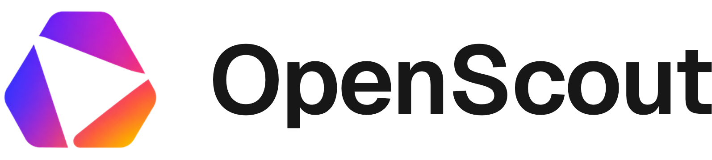

<p align="center">
  <picture>
    <source srcset=".github/assets/logo-dark.png" media="(prefers-color-scheme: dark)">
    <source srcset=".github/assets/logo-light.png" media="(prefers-color-scheme: light)">
    
  </picture>
</p>

---

<p align="center">Scouting and analytics for VEX Robotics events. Every event and every team, in one place, across V5RC, VIQRC, VURC and VAIRC.</p>

<p align="center">
  <a href="https://openscout.ing"></a>
  <a href="LICENSE"></a>
  
  
</p>

<p align="center">
  <a href="README.md">English</a> | <a href="README.zh-CN.md">简体中文</a><br>
  <a href="https://openscout.ing"></a>
</p>

---

## What it does

The data is all on VEX Events already. Getting at it is the tedious part. Finding the
handful of events near you next month means paging through everything happening
worldwide, and sizing up an opponent means opening their page in one tab and yours in
another.

So this is the same data, rearranged around what you're actually doing with it at a
competition.

| | |
| --- | --- |
| **Events** | Filters that narrow a season down to something you'd actually read: season, program, grade, region, event type. Worlds, Signature and Championship events get tagged as such, and Smart Sort floats the ones happening near you and near now. |
| **Teams** | Rankings, skills scores, match record, awards, and every season the team has competed in. There's a radar chart that puts win rate, AWP, consistency, world skills and experience on one shape, which is usually enough to tell whether a team is worth a closer look. |
| **Skills** | World skills leaderboards, driver and programming split out. |
| **Jumper** | The one people ask for most. Pick a match and it finds the right stream and seeks to the moment that match starts, instead of you dragging through six hours of livestream. Works with YouTube and BoxCast. |
| **My Team** | Pin your team and it follows you around: upcoming events, recent matches, and a place to write down what you noticed while it's still fresh. |
| **Shared teams** | Invite the rest of your club. The picklist you build together updates on everyone's screen as it changes, which beats three people editing the same spreadsheet in the pits. |
| **Translation** | Events from other regions get their names translated, so a Chinese signature event isn't just an unreadable row in your list. |

It installs as a PWA if you want it on a phone, anything you've already loaded still
works when the venue wifi gives out, and it follows your system light/dark setting.

<div align="center">

</div>

## Running it locally

Node 20 or newer.

```bash
git clone https://github.com/axcdeng/webscout.git
cd webscout
npm install
cp .env.example .env
npm run dev
```

That's it; one process serves the site and the API together, on
<http://localhost:5175>.

You will need an API key before anything shows up, though. All the competition data
comes from VEX Events and that's gated behind a token, so without one you get a
perfectly functional empty shell.

[.env.example](.env.example) is the real documentation here. Every variable has a
comment explaining what it does, whether it's genuinely secret, and what degrades if
you leave it blank. Roughly:

| Setting | What it unlocks |
| --- | --- |
| `ROBOTEVENTS_API_KEY` and `RSE_API_KEY` | Events, teams, rankings, matches |
| `VITE_SUPABASE_URL` and `VITE_SUPABASE_PUBLISHABLE_KEY` | Accounts, notes, shared teams, picklists |
| `VITE_DEFAULT_YOUTUBE_API_KEY` | Jumper |
| `UPSTASH_REDIS_REST_URL` and `_TOKEN` | Rate limiting (skip it locally, it no-ops) |

Only the second row is load-bearing for accounts. Skip Supabase entirely and browsing
still works fine; you just lose anything that saves state.

### Other commands

```bash
npm run build    # build for production
npm test         # run the tests
npm run lint     # check code style
npm run preview  # serve the production build
```

## How it fits together

```
src/          The front end. React and Vite.
  jumper/     Stream detection and the seek math behind match video.
server/       The API, and everything that talks to VEX Events.
api/          The same handlers again, as Vercel functions.
supabase/     Schema for accounts, notes, shared teams, picklists.
```

Schema changes live in `supabase/migrations/` and get applied by hand, in order, in the
Supabase SQL editor. They're all written to be safe to run twice, so if you lose track
of where you are you can just re-run from the top.

## Contributing

Issues and PRs welcome. Run this before you open one:

```bash
npm run lint && npx tsc -b && npm test
```

Two warnings. `src/App.tsx` is enormous and is being broken up gradually, so don't be
alarmed. And a schema change wants a new numbered migration rather than an edit to an
existing one (the old ones have already run on production databases).

## Security

If you find a security problem, email [contact@robostem.org](mailto:contact@robostem.org)
rather than filing a public issue.

## License

[GNU Affero General Public License v3.0](LICENSE).

Use it, fork it, run your own copy, all fine. The one real condition is that if you
modify it and run it as a public service, your changes have to be published under the
same license. If that doesn't work for what you have in mind, email
[contact@robostem.org](mailto:contact@robostem.org) and we can talk.

Geist and Geist Mono are Vercel's, under the
[SIL Open Font License 1.1](public/fonts/OFL.txt).

OpenScout isn't affiliated with or endorsed by VEX Robotics. Competition data comes
from VEX Events.
