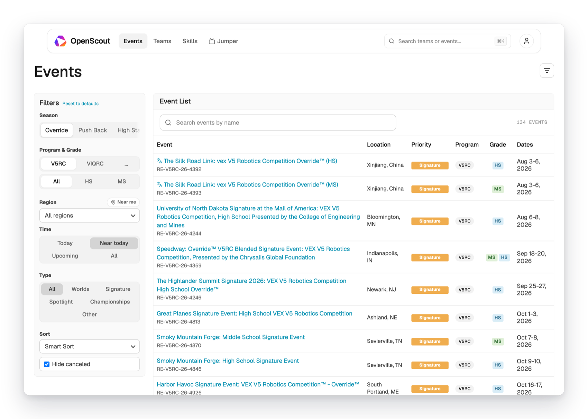
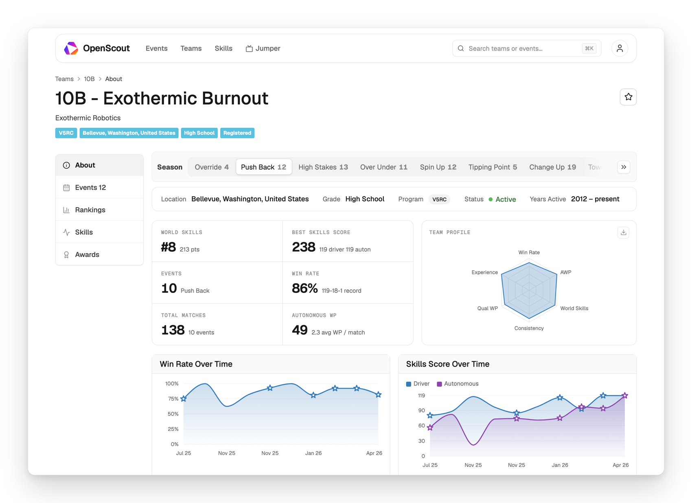

<div align="center">


# OpenScout

**Scouting and analytics for VEX Robotics events.**

Every event and every team, in one place. Covers V5RC, VIQRC, VURC, and VAIRC.

[](https://openscout.ing)
[](LICENSE)
[](https://react.dev)
[](https://www.typescriptlang.org)



</div>

---

## What it does

VEX Events has the data. OpenScout makes it usable.

You can filter events instead of scrolling past them. You can compare teams side by
side. You can keep notes where you will actually find them again.

| | |
| --- | --- |
| **Events** | Filter by season, program, grade, region, and type. Worlds, Signature, and Championship events are labeled. Smart Sort puts what is near you and near today at the top. |
| **Teams** | See rankings, skills scores, match records, and awards. Every past season is there too. A radar chart sums up a team at a glance. |
| **Skills** | World skills leaderboards, split by driver and programming. |
| **Jumper** | Watch any match without hunting through a six hour stream. Pick a match and it jumps to the right moment. |
| **My Team** | Pin your team. Track its events and recent matches. Write a note on any match. |
| **Shared teams** | Invite your club and build a picklist together. Changes show up on everyone's screen right away. |
| **Translation** | Event names from other countries are translated for you. |

You can install it like an app. Pages you have already opened still work offline. It
follows your system light or dark setting.

<div align="center">

</div>

## Running it locally

You need Node 20 or newer.

```bash
git clone https://github.com/axcdeng/webscout.git
cd webscout
npm install
cp .env.example .env
npm run dev
```

Open <http://localhost:5175>. One process runs both the site and the API. There is
nothing else to start.

You will need at least one API key. Competition data comes from VEX Events, and that
needs a token. Without one the site loads but stays empty.

[.env.example](.env.example) explains every setting. It says what each one does, which
ones are real secrets, and what breaks when you skip them. The short version:

| Setting | What it unlocks |
| --- | --- |
| `ROBOTEVENTS_API_KEY` and `RSE_API_KEY` | Events, teams, rankings, matches |
| `VITE_SUPABASE_URL` and `VITE_SUPABASE_PUBLISHABLE_KEY` | Accounts, notes, shared teams, picklists |
| `VITE_DEFAULT_YOUTUBE_API_KEY` | Jumper |
| `UPSTASH_REDIS_REST_URL` and `_TOKEN` | Rate limiting, safe to skip locally |

Accounts are optional. Browsing works without them. Only the features that save
something need an account.

### Other commands

```bash
npm run build    # build for production
npm test         # run the tests
npm run lint     # check code style
npm run preview  # serve the production build
```

## How it fits together

```
src/          The site. React and Vite.
  jumper/     Match video. Finds the stream and the right timestamp.
server/       The API. Also talks to VEX Events.
api/          The same API, as Vercel functions.
supabase/     Database setup for accounts and shared teams.
```

Database changes live in `supabase/migrations/`. Run them in order, by hand, in the
Supabase SQL editor. Running one twice is safe.

## Contributing

Issues and pull requests are welcome. Please run this first:

```bash
npm run lint && npx tsc -b && npm test
```

Two things to know. `src/App.tsx` is very large and is being split up over time. A
database change needs a new numbered file, not an edit to an old one.

## Security

Found a security problem? Please email
[contact@robostem.org](mailto:contact@robostem.org) instead of opening an issue.

## License

OpenScout is licensed under the [GNU Affero General Public License v3.0](LICENSE).

You can use it, change it, and host it yourself. If you run a changed version as a
public service, you have to share your source code under the same license. Email
[contact@robostem.org](mailto:contact@robostem.org) if you need different terms.

The Geist fonts are made by Vercel and have their own license, the
[SIL Open Font License 1.1](public/fonts/OFL.txt).

OpenScout is an independent project. It is not affiliated with or endorsed by VEX
Robotics. Competition data comes from VEX Events.
